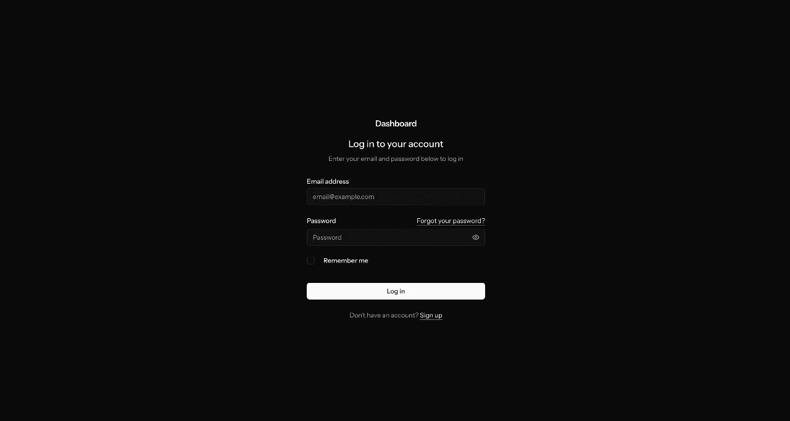

# Dashboard

A modern admin dashboard built with **Laravel 13**, **Vue 3**, **TypeScript**, and **Inertia.js**. It provides a clean, responsive interface with role-based access control, authentication via Laravel Fortify, two-factor authentication and passkeys (provided by [Laravel Passkeys](https://github.com/laravel/passkeys)), and a fully typed frontend powered by Vite and Tailwind CSS v4.



---

## Table of Contents

- [Requirements](#requirements)
- [Tech Stack](#tech-stack)
- [Architecture](#architecture)
- [Frontend Structure](#frontend-structure)
- [Multitenancy](#multitenancy)
- [Billing](#billing)
- [Backups](#backups)
- [Audit Log](#audit-log)
- [Installation](#installation)
- [Roles and Permissions](#roles-and-permissions)
- [Configuration](#configuration)
- [Running the Application](#running-the-application)
- [Local Development (Docker)](#local-development-docker)
- [Deployment (Laravel Cloud)](#deployment-laravel-cloud)
- [Testing](#testing)
- [Code Quality](#code-quality)
- [Scripts Reference](#scripts-reference)
- [Generated Frontend Routes](#generated-frontend-routes)
- [Local Quality Checks](#local-quality-checks)
- [Further Reading](#further-reading)
- [Security](#security)
- [Contributing](#contributing)
- [Licence](#licence)
- [Funding](#funding)

---

## Requirements

- PHP 8.3 or higher
- Composer
- Node.js 22.12 or higher
- npm
- A supported database: MySQL 8 or PostgreSQL 16 (both run in CI). SQLite is for local development only

---

## Tech Stack

**Backend**

- [Laravel 13](https://laravel.com) -- PHP framework
- [Laravel Fortify](https://laravel.com/docs/fortify) -- Authentication backend
- [Laravel Sanctum](https://laravel.com/docs/sanctum) -- API token authentication
- [Laravel Wayfinder](https://github.com/laravel/wayfinder) -- Named route generation for TypeScript
- [Spatie Laravel Permission v7](https://spatie.be/docs/laravel-permission) -- Role and permission management
- [Pest PHP](https://pestphp.com) -- Testing framework
- [Laravel Cashier](https://laravel.com/docs/billing) -- Stripe subscription billing
- [Spatie Laravel Multitenancy](https://spatie.be/docs/laravel-multitenancy) -- Organisation-based tenancy
- [Spatie Laravel Backup](https://spatie.be/docs/laravel-backup) -- Database and file backups
- [Log Viewer](https://log-viewer.opcodes.io) -- Browse application logs
- [Laravel DomPDF](https://github.com/barryvdh/laravel-dompdf) -- PDF generation
- [Mews Purifier](https://github.com/mewebstudio/purifier) -- HTML sanitisation for rich text
- [Larastan](https://github.com/larastan/larastan) -- Static analysis

**Frontend**

- [Vue 3](https://vuejs.org) with Composition API
- [TypeScript](https://www.typescriptlang.org)
- [Inertia.js](https://inertiajs.com) -- Server-driven SPA
- [Tailwind CSS v4](https://tailwindcss.com)
- [Reka UI](https://reka-ui.com) -- Headless UI components
- [Lucide Vue Next](https://lucide.dev) -- Icon library
- [Vite 8](https://vitejs.dev) -- Frontend build tool

---

## Architecture

Each resource follows the same service-oriented layout:

| Class | Responsibility |
| --- | --- |
| `ActiveCheckerService` | Whether a record can be modified, restored or force deleted |
| `CreatorService` / `UpdaterService` | Create and update, stamping audit columns |
| `DeleterService` / `RestorerService` | Soft delete and restore |
| `DataPreparationService` | Normalise validated input before persistence |
| `FilterService` / `SortingService` | Allow-listed filters and sort columns |
| `QueryService` | Build and paginate the index query |
| `FormatterService` | Shape data for Inertia props |
| `PolicyAuthorisationService` | Permission checks used by policies |
| `ManagementService` | Orchestrates the above for controllers |

Shared `App\Actions\*Resource` classes wrap transactions. Every state change is written to the audit log through `AuditLogService`.

Scaffold a new module with:

```bash
php artisan make:model {Model} -a
php artisan make:request Import{Model}Request
php artisan make:service {PluralModel}/{ServiceName}
```

For example, `php artisan make:service Users/CreatorService`.

After scaffolding, add the module's permissions to `RolePermissionSeeder`, register its policy in `AppServiceProvider`, and run `php artisan wayfinder:generate --with-form`.

---

## Frontend Structure

Pages live in `resources/js/pages/{Module}/`, with reusable pieces in `resources/js/pages/{Module}/components/`.

```text
resources/js/pages/Users/
    Index.vue
    Create.vue
    Edit.vue
    Show.vue
    components/
        UserForm.vue
        UserBasicDetailsForm.vue
        UserRoleDetailsForm.vue
        UserDateDetailsForm.vue
        UserBasicDetails.vue
        UserRoleDetails.vue
        UserDateDetails.vue
        UserAuditDetails.vue
```

- `Create.vue` and `Edit.vue` both render `UserForm.vue`, which composes the smaller form components. Each form component takes an `errors` prop and one `defineModel` per field.
- `Show.vue` composes the read-only detail components.
- Form-only types (for example `UserFormData`) are declared inside the form component. `resources/js/types/index.ts` holds model shapes only.
- Route helpers come from Laravel Wayfinder (`@/routes/...`), not Ziggy.

---

## Multitenancy

Data is scoped to an organisation using [Spatie Laravel Multitenancy](https://spatie.be/docs/laravel-multitenancy).

- `Organisation` is the tenant model. Users belong to organisations through the `organisation_user` pivot, which carries an organisation role (`owner`, `admin`, `member`).
- A user selects or switches organisation from the organisation switcher. Requests made without a current organisation are redirected to the organisation selection page.
- Tenant-scoped models use the `App\Traits\BelongsToOrganisation` trait and are listed in `config('organisations.scoped_models')`. Tables that are intentionally shared are listed in `config('organisations.central_tables')`.
- File storage paths are prefixed with `organisations/{id}/`, cache keys include the organisation id, and queued jobs are tenant aware.
- Organisation membership is a hard boundary. Organisation roles are separate from the application-wide roles described in [Roles and Permissions](#roles-and-permissions).

Isolation is covered by `tests/Feature/Tenancy/TenantHttpIsolationTest.php`. See [CONTRIBUTING.md](CONTRIBUTING.md) for the checklist to follow when adding a tenant-scoped module.

---

## Billing

Subscriptions use [Laravel Cashier](https://laravel.com/docs/billing) with Stripe.

Add your keys to `.env`:

```dotenv
STRIPE_KEY=
STRIPE_SECRET=
STRIPE_WEBHOOK_SECRET=
```

Forward webhooks to your local application with the Stripe CLI:

```bash
stripe listen --forward-to {APP_URL}/stripe/webhook
```

Copy the signing secret it prints into `STRIPE_WEBHOOK_SECRET`. Use Stripe's test card `4242 4242 4242 4242` with any future expiry date and any CVC.

Plans are seeded by `PlanSeeder` and managed from the Plans module.

---

## Backups

Backups use [Spatie Laravel Backup](https://spatie.be/docs/laravel-backup). Configure destinations in `config/backup.php`.

```bash
# Create a backup
php artisan backup:run

# List existing backups
php artisan backup:list

# Remove old backups according to the retention policy
php artisan backup:clean
```

To restore, unzip the backup archive, restore the files you need, and import the database dump:

```bash
mysql -u {user} -p {database} < db-dumps/{dump-file}.sql
```

Test a restore on a non-production environment before you rely on it.

---

## Audit Log

Every state change (create, update, delete, restore) is recorded through `AuditLogService`.

- Each entry stores the action, the acting user, the affected model and a before and after snapshot.
- Actions are integer constants on the `Log` model.
- Entries are signed with an HMAC using `AUDIT_LOG_HMAC_KEY`, so tampering with stored rows can be detected. Set a unique key in every environment and never commit it.

---

## Installation

Clone the repository and install dependencies:

```bash
git clone https://github.com/MattYeend/Dashboard.git
cd Dashboard
```

You can run the full setup in a single command:

```bash
composer run setup
```

This will:

1. Install Composer dependencies
2. Copy `.env.example` to `.env` (if not already present)
3. Generate an application key
4. Run database migrations and seed roles, permissions and reference data (the seeded users' shared password is printed once if you have not set `SEED_USER_PASSWORD`)
5. Install npm dependencies
6. Build frontend assets

Alternatively, run each step manually:

```bash
composer install
cp .env.example .env
php artisan key:generate
php artisan migrate --seed
npm install
npm run build
```

> **Seeded users:** `UserSeeder` creates local development accounts that share one password. Set `SEED_USER_PASSWORD` in `.env` to choose it, or leave it empty and a random password is generated and printed once when the seeder runs. `UserSeeder` refuses to run in production, so never seed production with development data.

---

## Roles and Permissions

This project uses [Spatie Laravel Permission v7](https://spatie.be/docs/laravel-permission/v7/installation-laravel) to manage roles and permissions. It supports assigning roles and permissions directly to users, teams-based permissions, wildcard permissions, and Blade directives for view-level access control.

For full usage documentation, refer to the [Spatie Laravel Permission v7 docs](https://spatie.be/docs/laravel-permission/v7/basic-usage/basic-usage).

### Seeded roles

`RolePermissionSeeder` creates the following roles. It is the authoritative source for the permission set of each role.

| Role | Summary |
| --- | --- |
| Super Admin | Every ability. Policy checks are bypassed by a `Gate::before` hook |
| Admin | Full management of modules, plans, billing and organisation membership |
| Manager | Create, view and edit access to most modules, without billing management |
| Editor | Scoped subset defined in `RolePermissionSeeder` |
| Viewer | Scoped subset defined in `RolePermissionSeeder` |
| Moderator | Scoped subset defined in `RolePermissionSeeder` |
| Support | Scoped subset defined in `RolePermissionSeeder` |
| Analyst | Scoped subset defined in `RolePermissionSeeder` |
| User | Scoped subset defined in `RolePermissionSeeder` |
| Guest | Scoped subset defined in `RolePermissionSeeder` |

---

## Configuration

Copy the example environment file and update it with your own values:

```bash
cp .env.example .env
```

Key variables to configure:

| Variable | Description |
|---|---|
| `APP_NAME` | The name displayed in the application |
| `APP_URL` | The base URL of your application |
| `DB_CONNECTION` | Database driver (`mysql`, `pgsql`, `sqlite`) |
| `DB_HOST` | Database host |
| `DB_DATABASE` | Database name |
| `DB_USERNAME` | Database username |
| `DB_PASSWORD` | Database password |
| `SEED_USER_PASSWORD` | Optional. Shared password for seeded development users. Leave empty to generate a random one |

---

## Running the Application

To start all services concurrently (web server, queue worker, log watcher, and Vite dev server):

```bash
composer run dev
```

This runs the following in parallel:

- `php artisan serve` -- Laravel development server
- `php artisan queue:listen` -- Queue worker
- `php artisan pail` -- Log viewer
- `npm run dev` -- Vite HMR dev server

To build frontend assets for production:

```bash
npm run build
```

---

## Local Development (Docker)

The Docker environment serves the application at `http://dashboard.test`. It is for local development only. Production runs on Laravel Cloud, which ignores the Docker files.

### Prerequisites

- Docker Desktop (or Docker Engine with the Compose plugin)
- Git
- Free ports `80`, `3306` (localhost only) and `5173`. Stop Laravel Herd or Valet first, as they use port 80

### Files

| File | Purpose |
|---|---|
| `Dockerfile` | PHP 8.3 FPM image with the required extensions and Composer |
| `docker-compose.yml` | App, Nginx, MySQL and Node (Vite) services |
| `docker/nginx/default.conf` | Nginx virtual host for `dashboard.test` |
| `.dockerignore` | Keeps `.env`, `vendor` and `node_modules` out of the image |

### Services

| Service | Container | Purpose | Port |
|---|---|---|---|
| `app` | `dashboard_app` | PHP 8.3 FPM running Laravel | internal |
| `nginx` | `dashboard_nginx` | Web server | 80 |
| `db` | `dashboard_db` | MySQL 8.4 | 127.0.0.1:3306 |
| `node` | `dashboard_node` | Vite dev server with HMR | 5173 |

### Setup

1. Copy the environment file and set Docker friendly values:

```bash
cp .env.example .env
```

```dotenv
APP_URL=http://dashboard.test
 
DB_CONNECTION=mysql
DB_HOST=db
DB_PORT=3306
DB_DATABASE=dashboard
DB_USERNAME=dashboard
DB_PASSWORD=
DB_ROOT_PASSWORD=
```

Set strong, unique values for `DB_PASSWORD` and `DB_ROOT_PASSWORD`. Never commit `.env`.

2. Add the local domain to your hosts file.

macOS and Linux:

```bash
echo "127.0.0.1 dashboard.test" | sudo tee -a /etc/hosts
```

Windows: add `127.0.0.1 dashboard.test` to `C:\Windows\System32\drivers\etc\hosts` using an editor run as administrator.

3. Build and start the containers, then install and migrate:

```bash
docker compose up -d --build
docker compose exec app composer install
docker compose exec app php artisan key:generate
docker compose exec app php artisan migrate --seed
docker compose exec app php artisan storage:link
```

4. Visit `http://dashboard.test`.

### Common Docker Commands

```bash
docker compose up -d                                  # Start containers
docker compose down                                   # Stop containers
docker compose ps                                     # Check container health
docker compose logs -f app                            # Follow application logs
docker compose exec app php artisan tinker            # Open Tinker
docker compose exec app php artisan test              # Run the Pest test suite
docker compose exec app php artisan queue:listen      # Run the queue worker
docker compose exec app php artisan config:clear      # Clear cached config
docker compose exec app php artisan wayfinder:generate --with-form
docker compose build --pull                           # Rebuild with the latest base images
```

The Docker setup does not start a queue worker automatically. Run `queue:listen` in a separate terminal when you need queued jobs processed.

### Troubleshooting

- **Port 80 already in use:** stop Laravel Herd, Valet or any local web server, then run `docker compose up -d` again.
- **`dashboard.test` does not load:** confirm the hosts file entry exists and clear your browser DNS cache.
- **Vite HMR not updating:** check `hmr.host` in `vite.config.ts` is `dashboard.test` and that port `5173` is free.
- **Database connection refused on first start:** the `db` container needs a few seconds to become healthy. Check with `docker compose ps`.
- **Permission errors in `storage` or `bootstrap/cache`:** set `UID` and `GID` in your shell to match your user (`id -u` and `id -g`), then rebuild with `docker compose up -d --build`.

---

## Deployment (Laravel Cloud)

Laravel Cloud builds from the Git repository and runs its own managed PHP, so `Dockerfile`, `docker-compose.yml` and `docker/` are ignored in production.

### Environment settings

- Set the PHP version to **8.4** or higher in the environment settings. `composer.lock` requires PHP 8.4.1.
- Attach a Cloud managed **PostgreSQL** database. Cloud injects `DB_CONNECTION`, `DB_HOST`, `DB_PORT`, `DB_DATABASE`, `DB_USERNAME` and `DB_PASSWORD` itself, so do not copy the Docker MySQL values across.
- Enable a queue worker if you use `QUEUE_CONNECTION=database`, otherwise queued jobs never run.

### Environment variables

Set these in the Laravel Cloud dashboard, not in a committed `.env`. Never paste real values into issues, chat or the README.

Injected by Cloud (check they exist, do not set them yourself):

```dotenv
APP_ENV=production
APP_DEBUG=false
APP_URL=https://main-dashboard.laravel.cloud
LOG_CHANNEL=laravel-cloud-socket
LOG_STDERR_FORMATTER=Monolog\Formatter\JsonFormatter
SESSION_DRIVER=cookie
CACHE_STORE=database
SCHEDULE_CACHE_DRIVER=database
```

Custom variables:

```dotenv
APP_NAME="Dashboard"
APP_KEY=
APP_PREVIOUS_KEYS=

LOG_LEVEL=warning
LOG_VIEWER_ENABLED=false
LARADOCS_ENABLED=false
LARADOCS_ROUTE_REGISTER=false

SESSION_ENCRYPT=true
SESSION_SECURE_COOKIE=true
SESSION_SAME_SITE=lax
SESSION_DOMAIN=null

SANCTUM_STATEFUL_DOMAINS=main-dashboard.laravel.cloud
CORS_ALLOWED_ORIGINS=https://main-dashboard.laravel.cloud

STRIPE_KEY=
STRIPE_SECRET=
STRIPE_WEBHOOK_SECRET=
CASHIER_CURRENCY=gbp
CASHIER_CURRENCY_LOCALE=en_GB

MAIL_MAILER=smtp
MAIL_SCHEME=null
MAIL_HOST=
MAIL_PORT=587
MAIL_USERNAME=
MAIL_PASSWORD=
MAIL_FROM_ADDRESS=
MAIL_FROM_NAME="Dashboard"

AUDIT_LOG_HMAC_KEY_ID=v1
AUDIT_LOG_HMAC_KEY=
AUDIT_LOG_HMAC_RETIRED_KEYS=

BACKUP_DISK=s3
BACKUP_NOTIFICATION_EMAIL=
BACKUP_ARCHIVE_PASSWORD=
```

Notes:

- `AUDIT_LOG_HMAC_KEY` is required outside local and testing. The application refuses to boot without it.
- Use live-mode Stripe keys for real payments. `STRIPE_WEBHOOK_SECRET` must come from a webhook endpoint created in Stripe for `https://main-dashboard.laravel.cloud/stripe/webhook`, not from the Stripe CLI.
- Generate secrets with `php -r "echo bin2hex(random_bytes(32)).PHP_EOL;"`.
- `SEED_USER_PASSWORD` is not needed in production, because `UserSeeder` refuses to run there.

### Build commands

```bash
composer install --no-dev --optimize-autoloader
npm ci
npm run build
```

### Deploy commands

```bash
php artisan migrate --force
php artisan config:cache
php artisan route:cache
php artisan view:cache
```

### First deploy

Do not seed on every deploy. Run the permissions seeder once, manually, from the Cloud command runner:

```bash
php artisan db:seed --class=RolePermissionSeeder --force
```

`UserSeeder` refuses to run in production, so create the first Super Admin user manually from the command runner with `php artisan tinker`, using a strong unique password.

### After deploying

- Run `php artisan backup:run` once and confirm `pg_dump` is available, as live uses PostgreSQL.
- Configure the `BACKUP_DISK` storage (S3 or Cloud object storage), otherwise backups fail.
- Send a test email to confirm the SMTP credentials work.
- Trigger a test event from the Stripe dashboard and confirm the webhook is accepted.

### Custom domain

Add the domain in the environment's domain settings and create the DNS record Cloud provides. SSL is handled automatically. When the domain changes, update `APP_URL`, `SANCTUM_STATEFUL_DOMAINS`, `CORS_ALLOWED_ORIGINS` and the Stripe webhook endpoint to match. Menu labels in the Cloud dashboard change between releases, so confirm them there.

### Local and live database difference

Local Docker runs MySQL 8.4 and live runs PostgreSQL. CI covers both, but to reduce surprises, you can switch the Docker `db` service to PostgreSQL.

---

## Testing

Tests are written using [Pest PHP](https://pestphp.com).

Run the full test suite:

```bash
php artisan test
```

Or via Composer:

```bash
composer run test
```

This also clears the config cache and runs the linter before executing tests.

---

## Code Quality

The project uses several tools to maintain code quality and consistency.

**PHP linting with Pint:**

```bash
# Fix violations
composer run lint

# Check only (no fixes applied)
composer run lint:check
```

**Static analysis with Larastan:**

```bash
composer run analyse
```

**Run every CI check locally:**

```bash
composer run ci:check
```

**Frontend linting with ESLint:**

```bash
# Fix violations
npm run lint

# Check only
npm run lint:check
```

**Code formatting with Prettier:**

```bash
# Format resources/
npm run format

# Check only
npm run format:check
```

**TypeScript type checking:**

```bash
npm run types:check
```

---

## Scripts Reference

| Command | Description |
|---|---|
| `composer run setup` | Full project setup |
| `composer run dev` | Start all dev services |
| `npm run dev` | Start Vite dev server |
| `npm run build` | Build frontend for production |
| `npm run lint` | Fix ESLint violations |
| `npm run lint:check` | Check ESLint violations (no fixes applied) |
| `npm run format` | Format with Prettier |
| `npm run format:check` | Check formatting (no fixes applied) |
| `npm run types:check` | Check TypeScript types |
| `php artisan test` | Run the full Pest PHP test suite |
| `php artisan make:service {Model}/{ServiceName}` | Scaffold a service, for example `Companies/CreatorService` |
| `composer run analyse` | Run Larastan static analysis |
| `composer run ci:check` | Run the PHP checks CI runs (lint, analysis, tests) |
| `composer run lint:check` | Check PHP style with Pint (no fixes applied) |
| `composer audit` | Check PHP dependencies for known vulnerabilities |
| `npm audit` | Check JavaScript dependencies for known vulnerabilities |

---

## Generated Frontend Routes

After changing Laravel routes or controllers, regenerate frontend route/action files:

```bash
php artisan wayfinder:generate --with-form
npm run types:check
```

Generated files live in:

- `resources/js/actions`
- `resources/js/routes`

---

## Local Quality Checks

Run before opening a PR:

```bash
composer test
npm run lint:check
npm run types:check
npm run build
```

To install for production, skip development packages (Laravel Brain, Laradocs and test tooling):

```bash
composer install --no-dev --optimize-autoloader
```

---

## Further Reading

More artisan commands can be found <a href="https://artisan.page/" target="_blank">here</a>

---

## Security

Report vulnerabilities privately as described in [SECURITY.md](SECURITY.md). Do not open public issues for security problems.

---

## Contributing

Contributions are welcome. Please read [CONTRIBUTING.md](CONTRIBUTING.md) first, then open an issue or submit a pull request. Ensure all tests pass and code style checks succeed before submitting.

1. Fork the repository
2. Create a feature branch (`git checkout -b feature/{issue-number}-{short-name}`)
3. Commit your changes (`git commit -m "#{issue} {Message}"`)
4. Push to the branch (`git push origin feature/{issue-number}-{short-name}`)
5. Open a Pull Request

---

## Licence

This project is licenced under the [MIT Licence](LICENSE).

---

## Funding

If you find this project useful and would like to support its development, you can do so through the following:

- [Sponsor MattYeend on GitHub](https://github.com/sponsors/MattYeend)
- [Buy Me a Coffee](https://www.buymeacoffee.com/mattyeend)